# IMO 组合预选题：全局证明逻辑图

按 **题目与定义 → 基础引理 → 坐标化 → 极小性 → 匹配 → 计数 → 最终结论** 从左到右阅读。每列内部从上到下展开；旁支列出旧强化目标、已有特殊情形与反例审计，说明它们在整个项目中的作用。

对应最终源码：[IMO组合预选题_零告警.lean](C:/Users/18746/Desktop/数竞屠宰场/IMO组合预选题_零告警.lean)。[旧版 Lean 文件](C:/Users/18746/Desktop/数竞屠宰场/IMO组合预选题.lean) 继续保留。

记号：F 为原覆盖族，s 为块数，n 为真实公差最小公倍数；αₚ = vₚ(n)，βₚ(ν) = vₚ(ν)，mν 为公差恰好等于 ν 的块数。b(r) = 1 + Σₚ vₚ(r)(p − 1)，σ = Σν max(mν − b(ν), 0)。位变量 (p,t) 的值域有 p 个值，复制成 p − 1 个槽。S(G) 为子族 G 使用的槽的并集，δ(G) = |G| − |S(G)|，在整数 ℤ 中计算。

```mermaid
flowchart LR
  subgraph INPUT["① 题目、对象与目标"]
    direction TB
    A1["有限 AP 族：Aᵢ = aᵢ + dᵢℤ<br/>MemAP；dᵢ ＞ 0"]
    A2["覆盖条件：每个整数属于某个 Aᵢ<br/>独占条件：每个 Aᵢ 都有自己的独占点<br/>Essential"]
    A3["n = lcm(dᵢ)；s = 块数<br/>lcmDiff；bound：b(n) = 1 + Σₚ αₚ(p − 1)"]
    A4["原题目标：s ≥ b(n)<br/>同时证明强化目标：s ≥ b(n) + σ"]
    A1 ~~~ A2 ~~~ A3 ~~~ A4
  end

  subgraph FOUNDATION["② 基础层：AP、lcm、素因子与分组"]
    direction TB
    B1["整数 AP 归属等价于整除<br/>m ∈ Aᵢ ⇔ dᵢ 整除 m − aᵢ"]
    B2["每个 dᵢ 整除真实 n，且 n ＞ 0<br/>dvd_lcmDiff；lcmDiff_pos<br/>由素因子分解得 βₚ(dᵢ) ≤ αₚ"]
    B3["lcm 中每个素数幂最大指数由某块取得<br/>exists_of_prime_pow_dvd_lcm_finset<br/>→ exists_of_prime_pow_dvd_lcmDiff"]
    B4["按真实公差分组：mν = diffCount d ν<br/>Σν mν = s：diffCount_sum<br/>σ = Σν max(mν − b(ν), 0)"]
    B1 ~~~ B2
    B2 --> B3
    B3 ~~~ B4
  end

  subgraph COORDINATES["③ CRT 与位坐标：精确模型"]
    direction TB
    C1["CRT：模 n 由各模 p^αₚ 坐标组成<br/>每个素数幂坐标作定长 p 进位展开"]
    C2["encode / decode 互逆<br/>前 β 位相同 ⇔ 模 p^β 同余<br/>整数余数处理使负整数同样适用"]
    C3["任意完整位向量都由一个整数实现<br/>realize_coordinates → APDigitMatching.realize"]
    C4["每个 AP 恰是坐标积中的一个盒子<br/>Aᵢ 固定各 p 的前 βₚ(dᵢ) 位<br/>memAP_iff_digits"]
    C1 --> C2 --> C3 --> C4
  end

  subgraph MINIMALITY["④ 覆盖与独占：极小不可满足性"]
    direction TB
    D1["将每个盒子的补条件写为子句 Cᵢ<br/>Cᵢ：至少一个被固定的位与指定值不同"]
    D2["覆盖全部整数 ＋ 任意位向量可实现<br/>⇒ 覆盖全部坐标积<br/>⇒ 全部子句不可能同时满足"]
    D3["块 i 的独占点属于该盒而避开所有其他盒<br/>⇒ 它的位赋值满足除 Cᵢ 外的所有子句<br/>⇒ 每个真子族都可满足"]
    D4["得到极小不可满足子句族 F<br/>每变量值域为 qᵥ，每条子句在一个变量上只禁止一个值"]
    D1 --> D2
    D1 --> D3
    D2 --> D4
    D3 --> D4
  end

  subgraph STABILITY["⑤ 匹配核心 I：严格亏格稳定性"]
    direction TB
    E1["反设某真子族 G 满足 δ(G) ≥ δ(F)<br/>于是可选一个真子族 H，使 δ(H) 全局最大"]
    E2["对所有 J ⊆ F ∖ H：δ(H ∪ J) ≤ δ(H)<br/>整理为 |J| ≤ |S(J) ∖ S(H)|<br/>得到剩余子句侧的 Hall 条件"]
    E3["第一次 Hall：剩余子句单射匹配到新槽<br/>每条子句匹配的槽属于自己的变量<br/>maximal_complement_matching"]
    E4["一个变量至多负责 qᵥ − 1 条子句<br/>这些子句至多禁止 qᵥ − 1 个值<br/>选择未禁值，满足所有负责的子句"]
    E5["H 为真子族，先取得满足 H 的赋值<br/>新槽所属变量不出现在 H 中<br/>可合并旧赋值与新赋值"]
    E6["合并后满足 F 全部子句，矛盾<br/>proper_complement_matching_impossible"]
    E7["严格稳定性：G 真包含于 F ⇒ δ(G) ＜ δ(F)<br/>strict_deficiency"]
    E1 --> E2 --> E3 --> E4
    E1 --> E5
    E4 --> E6
    E5 --> E6 --> E7
  end

  subgraph FULLMATCH["⑥ 匹配核心 II：全槽匹配与余块"]
    direction TB
    F1["变量 (p,t) 复制 p − 1 个槽<br/>owner_capacity：每变量槽数 ＜ 值域大小<br/>由最大指数取得引理：每个槽确实被某块使用"]
    F2["总槽数 W = Σₚ αₚ(p − 1) = b(n) − 1<br/>APDigitMatching.slots_card"]
    F3["任取槽集 T，N(T) 为碰到 T 的子句<br/>取 G = F ∖ N(T)，则 S(G) 与 T 不交<br/>δ(G) ≥ δ(F) + |T| − |N(T)|"]
    F4["若 |N(T)| ＜ |T|，则 δ(G) ＞ δ(F)，矛盾<br/>故 |T| ≤ |N(T)|：槽侧 Hall 条件<br/>第二次 Hall 给出全槽到不同块的单射 f"]
    F5["空子族的亏格为 0；F 非空且严格稳定<br/>故 δ(F) ≥ 1，即 s ≥ W + 1<br/>存在一个未被匹配使用的余块 anchor"]
    F6["证书：全槽单射匹配 f ＋ 余块 anchor<br/>minimal_cover_matching"]
    F1 --> F2 --> F3 --> F4
    F2 --> F5
    F4 --> F6
    F5 --> F6
  end

  subgraph GROUPCOUNT["⑦ 组容量：由匹配证书推出截断下界"]
    direction TB
    G1["同差 ν 的全部块固定相同类型的前缀坐标<br/>共同支持槽集 Sν 的大小 = b(ν) − 1<br/>group_slots_card"]
    G2["选择全部匹配块，再加 anchor，得到指标集合 K<br/>|K| = W + 1 = b(n)<br/>K 是计数证书，不要求 K 自己仍然覆盖"]
    G3["同组匹配块对应不同的 Sν 中的槽<br/>因此该组的匹配块数 ≤ b(ν) − 1<br/>加 anchor 后 |K ∩ 公差ν组| ≤ min(mν,b(ν))"]
    G4["按公差组求和：b(n) ≤ Σν min(mν,b(ν))<br/>matching_capacity_bound → finite_box_capacity_bound<br/>→ truncated_cover_bound：TGT"]
    G1 --> G3
    G2 --> G3 --> G4
  end

  subgraph CONCLUSION["⑧ 代数装配：强化版与原题"]
    direction TB
    H1["逐组：min(mν,b(ν)) + max(mν − b(ν),0) = mν<br/>结合 Σν mν = s：Σν min(mν,b(ν)) + σ = s<br/>truncated_sum_add_sigma"]
    H2["TGT ＋ 上述恒等式<br/>⇒ s ≥ b(n) + σ<br/>T23prime"]
    H3["σ ≥ 0 ⇒ s ≥ b(n)<br/>card_ge_bound_of_allEssential"]
    H4["将指标类型取为 Fin s，card(Fin s) = s<br/>得到题目要求的结论<br/>problem7"]
    H1 --> H2 --> H3 --> H4
  end

  INPUT ==> FOUNDATION ==> COORDINATES ==> MINIMALITY ==> STABILITY ==> FULLMATCH ==> GROUPCOUNT ==> CONCLUSION

  subgraph STRONG["最终结论的推论旁支：旧强化目标"]
    direction TB
    J1["一般覆盖先取极小子覆盖 J<br/>exists_minimal_subcover"]
    J2["原族每个本质块都必须出现在任何子覆盖中<br/>⇒ essLcm(F) 整除 lcm(J)"]
    J3["J 本质且覆盖：b(lcm(J)) ≤ |J|<br/>bound_le_of_dvd：b(essLcm(F)) ≤ b(lcm(J))<br/>并且 |J| ≤ s"]
    J4["ρ 为非本质块数，ρ ≥ 0<br/>⇒ s + ρ ≥ b(essLcm(F))<br/>main_induction_strong"]
    J1 --> J2 --> J3 --> J4
  end
  FOUNDATION -. "极小子覆盖与整除单调性" .-> STRONG
  CONCLUSION -. "已完成的本质覆盖下界" .-> STRONG

  subgraph AUXILIARY["已有形式化工具旁支：保留，但最终主链无需调用"]
    direction TB
    K1["模 n 的有限块模型<br/>mem_block_iff；cover_block；private_block；card_block"]
    K2["素数及素数幂特殊情形<br/>base_case；case_prime；case_prime_sq<br/>case_prime_pow_step → case_prime_pow"]
    K3["纤维归约与冗余度工具<br/>fiber_memAP_iff；fiber_cover；fiber_essential<br/>essLcm 与 rho；sum_rho_le 等"]
    K4["已有算术和本质性工具<br/>bound_mul_prime_pow；bound_mul_add_one；bound_lcm_sum<br/>no_containment_of_essential；min_sub_min_eq"]
    K1 ~~~ K2 ~~~ K3 ~~~ K4
  end
  FOUNDATION -. "既有独立分支" .-> AUXILIARY

  subgraph AUDIT["历史探索与反例审计：不是最终证明前提"]
    direction TB
    L1["真实 n = 720 的两个全本质覆盖<br/>SigmaRouteAudit.legal_counterexample<br/>SigmaRouteAudit.legal_counterexample_B"]
    L2["证伪 A / B / V / U'' / deep_saturation 候选<br/>这些候选不能作为主证明的前提"]
    L3["另有独立的代数勘误<br/>min(m,Σbₚ) ≤ Σmin(m,bₚ)<br/>旧重组遗漏交叠损失 H，不能按旧链闭合"]
    L1 --> L2
    L2 ~~~ L3
  end
  AUXILIARY -. "旧方案的核验记录" .-> AUDIT

  classDef input fill:#f1f5f9,stroke:#475569,color:#0f172a;
  classDef foundation fill:#e0f2fe,stroke:#0284c7,color:#0c4a6e;
  classDef core fill:#ede9fe,stroke:#7c3aed,color:#4c1d95;
  classDef counting fill:#fef3c7,stroke:#d97706,color:#78350f;
  classDef result fill:#dcfce7,stroke:#15803d,stroke-width:2px,color:#14532d;
  classDef auxiliary fill:#f8fafc,stroke:#94a3b8,stroke-dasharray:5 5,color:#475569;
  classDef audit fill:#fff1f2,stroke:#e11d48,stroke-dasharray:5 5,color:#881337;
  class A1,A2,A3,A4 input;
  class B1,B2,B3,B4,C1,C2,C3,C4 foundation;
  class D1,D2,D3,D4,E1,E2,E3,E4,E5,E6,E7,F1,F2,F3,F4,F5,F6 core;
  class G1,G2,G3,G4,H1 counting;
  class H2,H3,H4,J4 result;
  class J1,J2,J3,K1,K2,K3,K4 auxiliary;
  class L1,L2,L3 audit;
```

**读图要点。** 粗实线连接全局主证明的八个阶段；每列内部的实线表示在本题已有前提下的推导，独立前提和工具仅上下排列，不用箭头暗示彼此推出。虚线连接项目中的旁支，不把已有特殊情形、历史反例或旧候选当作主定理的必要前提。各阶段使用前面已经获得的条件，具体包括：②的最大指数取得性质供⑥证明全部槽被使用，②的分组核数恒等式供⑧消去截断求和，③的同差共同前缀性质供⑦计算组容量。

两次 Hall 的方向不同：⑤将**剩余子句匹配到新槽**，构造满足赋值并反证；⑥将**全部槽匹配到不同块**，生成计数证书。独占点提供极小不可满足性；真实 lcm 提供所有位槽确实被使用；同差共同支持提供逐组上界。这三种信息在证明中承担不同作用。

| 层级 | 主要 Lean 对应 |
| --- | --- |
| 题目与基础 | `MemAP`、`Essential`、`lcmDiff`、`bound`、`dvd_lcmDiff`、`lcmDiff_pos`、`exists_of_prime_pow_dvd_lcmDiff`、`diffCount_sum` |
| 坐标模型 | `DigitCoordinates` 与 `APDigitMatching.memAP_iff_digits`、`realize` |
| 亏格与匹配 | `MinimalCoverMatching.strict_deficiency`、`matching_of_deficiency_maximum`、`minimal_cover_matching` |
| 计数接驳 | `owner_capacity`、`slots_card`、`group_slots_card`、`matching_capacity_bound`、`finite_box_capacity_bound` |
| 最终装配 | `truncated_cover_bound`、`truncated_sum_add_sigma`、`T23prime`、`card_ge_bound_of_allEssential`、`problem7` |
| 强化旁支 | `exists_minimal_subcover`、`bound_le_of_dvd`、`main_induction_strong` |

一般亏格稳定性与极小不可满足理论是 Kullmann（2011）文献中的已有工具，本项目从 Mathlib Hall 重新构造 Lean 证明，未添加文献公理。CRT 和数字展开使用库的一般结论。

零告警副本已经通过严格 Lean 验证。最终定理的公理检查仅含 `propext`、`Classical.choice`、`Quot.sound`，不含 `sorryAx`。旧 `Pp_bound`、`Rp_bound` 开放目标保留在旧版文件中，零告警副本已移除它们；它们不在本图的主证明链中。
