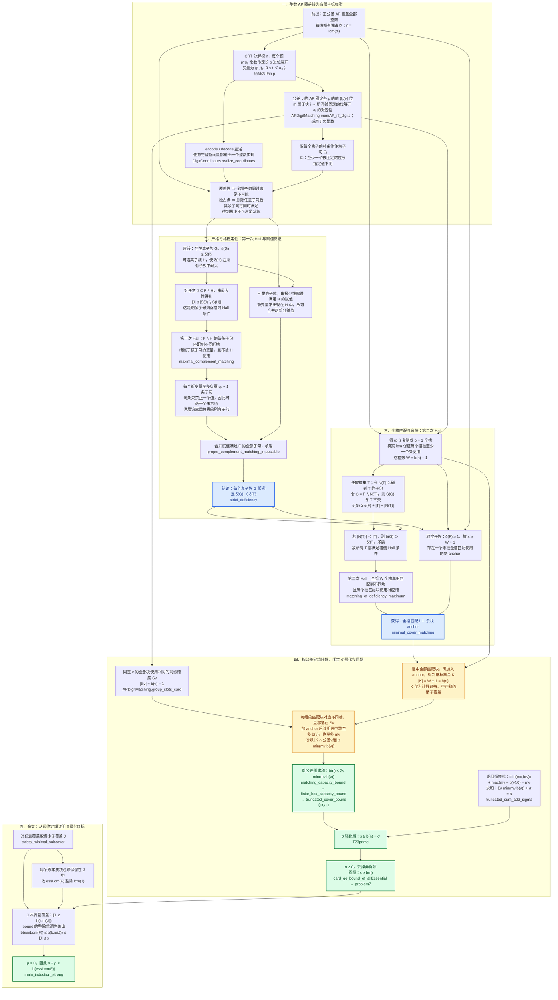

# IMO 组合预选题：最终证明逻辑图

最新版的全局分层图见 [IMO组合预选题_全局证明逻辑图.md](C:/Users/18746/Desktop/数竞屠宰场/IMO组合预选题_全局证明逻辑图.md)，按从左到右展开，补齐题目定义、基础引理、已有工具和最终结论。本文件保留为先前阶段图。

本图对应 [IMO组合预选题.lean](C:/Users/18746/Desktop/数竞屠宰场/IMO组合预选题.lean:3408) 中已完成的全局匹配证明。图中的箭头表示推导或必要输入；最后的旁支给出旧强化目标的完整证明。

另有 [零告警交付副本](C:/Users/18746/Desktop/数竞屠宰场/IMO组合预选题_零告警.lean)，最终证明链完全一致；它移除了图外未使用的 `Pp_bound` / `Rp_bound` 开放目标，旧 Lean 文件原样保留。

记号：原覆盖族为 F，块数为 s，真实公差最小公倍数为 n。设 αₚ = vₚ(n)，βₚ(ν) = vₚ(ν)，mν 为公差恰好等于 ν 的块数。

- b(r) = 1 + Σₚ vₚ(r)(p − 1)，对应 Lean 的 `bound`。
- σ = Σν max(mν − b(ν), 0)，对应 Lean 的 `sigma`。
- 每个位变量 v 的值域大小为 qᵥ；将它复制成 qᵥ − 1 个槽。在本题中 qᵥ = p。
- S(G) 是子句子族 G 使用的槽的并集，δ(G) = |G| − |S(G)|；亏格在整数 ℤ 中计算。

两次 Hall 的方向不同：第一次将“剩余子句”匹配到“新槽”，用于构造满足赋值并反证；第二次将“全部槽”匹配到“不同块”，用于最终计数。独占点在第一阶段提供极小不可满足性；真实 lcm 在第三阶段确保全部槽确实被使用。

一般亏格稳定性与极小不可满足理论属于已有文献工具（Kullmann，2011），这里用 Mathlib 的 Hall 定理在 Lean 中重新证明，未加入文献公理。CRT 和数字展开使用库的一般结论。

全文件已通过 Lean 验证；`truncated_cover_bound`、`T23prime`、`problem7`、`main_induction_strong` 的公理检查仅含 `propext`、`Classical.choice`、`Quot.sound`，不含 `sorryAx`。旧路线的 `Pp_bound`、`Rp_bound` 仍是开放辅助目标，**不在本图的最终证明依赖链中**。
